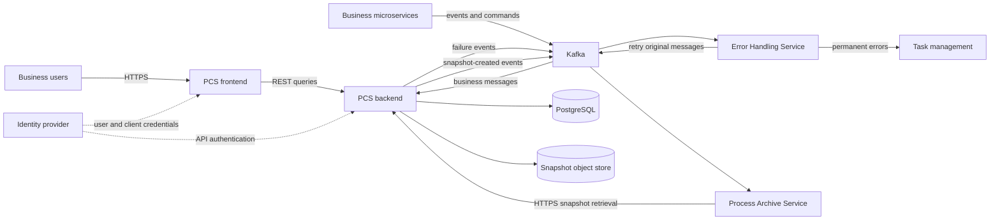
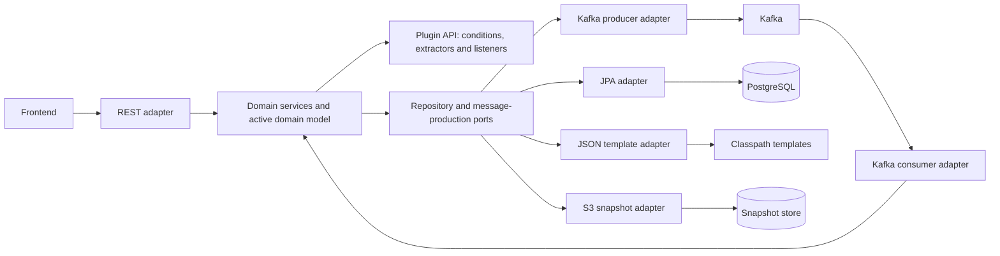

# Architecture

The Process Context Service (PCS) is a generic, largely **passive** service that provides a process context
to the microservices participating in a process in an event driven architecture.

## Goals

In an orchestration based architecture, the process context is maintained by a process engine. It essentially
comprises the process request, the state of the individual process steps and their results. Based on that
information the orchestrator decides which activities are required, when an activity can be started, and
parameterises the activities it starts.

An event driven architecture has no central orchestrator: services react to events on their own and execute
the required actions. That has advantages, but also drawbacks:

- **Transparency** — which process instances exist, what state are they in, what has happened so far?
- **Data flow** is harder, especially with indirect dependencies between worker services.
- **Complex dependencies** — as long as an activity is started by exactly one event this is simple, but as
  soon as several events have to be combined (join) it quickly becomes complex.

The PCS addresses these drawbacks by providing a central process context to the autonomously acting services.

### The PCS is strictly passive

It does:

- instantiate process instances when it receives a message that is configured to do so,
- listen to messages (events, commands) of the workers and update the process context,
- publish events about changes of the process context that workers can react to.

It is **not** an orchestrator and must never:

- decide which activities are to be executed — that is the responsibility of the workers,
- trigger an activity by sending a command.

## Domain terms

| Term                             | Meaning                                                                                                                     |
|----------------------------------|-----------------------------------------------------------------------------------------------------------------------------|
| Process                          | A set of logically connected activities (tasks) executed to reach a certain goal.                                            |
| Process template                 | Defines how a process runs: the expected tasks and their cardinality.                                                        |
| Process instance                 | An instance of a process, created based on a process template.                                                               |
| Task type                        | Description of a task within a process, in particular by task name and cardinality.                                          |
| Task instance                    | An instance of a task. Depending on the cardinality there can be several instances per task type.                            |
| Mandatory single-instance task   | Task with a cardinality of 1, has to be executed exactly once in the process.                                                |
| Optional single-instance task    | Task with a cardinality of 0..1.                                                                                            |
| Multi-instance task              | Task with a cardinality of 0..n.                                                                                            |
| Pending message                  | A message for which no process instance existed yet when it was received. It is assigned to the process instance as soon as that instance is created. |
| Process snapshot                 | The state of a process instance at a given point in time, for archiving by a Process Archive Service instance.               |

## Quality goals

| Prio | Category            | Quality goal    | Rationale                                                                                                                                    |
|------|---------------------|-----------------|----------------------------------------------------------------------------------------------------------------------------------------------|
| 1    | Functional suitability | Correctness  | Task and process states must be maintained consistently and the resulting events produced correctly — including under the asynchronous nature of event communication and eventual consistency. |
| 2    | Portability         | Adaptability    | Teams must be able to fulfil their process tracking requirements through configuration.                                                       |
| 3    | Maintainability     | Reusability     | Several teams use the same basis for the process context service of their business application.                                              |
| 4    | Usability           | Comprehensibility | Configuring process templates must be understandable and simple.                                                                            |
| 5    | Security            | Authenticity    | Access is protected by authentication and authorization (roles on UI and APIs, permissions on topics).                                        |
| 6    | Reliability         | Fault tolerance | Plugins, asynchronous communication with eventual consistency and temporary inconsistencies between instances and templates during deployments are possible sources of error; the service is designed to cope with smaller inconsistencies and to handle the rest robustly. |

High **availability** is explicitly less important: because of the decoupling and the passive character of
the service, and because the frontend serves traceability and analysis rather than business-critical
operations.

## Stakeholders

Business users need process transparency and diagnostic information. Feature teams need a stable
integration contract and understandable templates. Release Train Engineers coordinate adoption and
operation across teams; architects assess the service's fit with the event-driven system.

The [domain model](domain-model.md) explains the aggregate relationships and the separate plugin context.

## Context

### Business context

| Data flow                       | Description                                                                                                                                                   |
|---------------------------------|---------------------------------------------------------------------------------------------------------------------------------------------------------------|
| Messages (domain events, commands) | Messages relevant for the process state. They contain a process ID or can be correlated to a process instance via a reference or their payload. They can create new process instances if the template says so. |
| `ProcessSnapshotCreatedEvent`   | Event notification when a process snapshot has been created.                                                                                                   |
| Process state                   | The state of the process and its tasks, presented as a checklist in a user interface, and provided as a process snapshot for archiving.                        |

### Technical context

| Component               | Channel        | Description                                                                                                                                            |
|-------------------------|----------------|----------------------------------------------------------------------------------------------------------------------------------------------------------|
| Browser                 | HTTPS          | Read-only access to the REST API to display the state of a process.                                                                                     |
| Microservices           | Kafka          | Produce domain events that the PCS consumes to track the state of the process instances.                                                                 |
| Process Archive Service | Kafka, HTTPS   | Is informed about new snapshots by the `ProcessSnapshotCreatedEvent` and fetches the snapshots for archiving via the REST API.                           |
| Error Handling Service  | Kafka          | `MessageProcessingFailedEvent`s for messages whose processing failed are produced to the error topic; retries are published back to the original topic. |

### Context diagram

User access uses the authorization-code flow; service-to-service snapshot access uses client
credentials. The identity-provider realms and task-management credentials belong to the deployment.
The PAS reads snapshot bytes through the PCS API and stores its own archived artifact; the PCS
snapshot store and PAS archive store have separate retention policies.

### Platform constraints

The service follows the platform conventions for authentication and authorization, REST APIs,
Kafka messaging, frontend/backend deployment, logging and distributed tracing. Service-specific
settings are in [Configuration](configuration.md), authorization in [User interface](user-interface.md#roles),
and deployment and scaling in [Operations](operations.md#deployment).

## Runtime overview

See [Runtime behavior](runtime-behavior.md#runtime-overview) for the message-flow diagram and processing stages.

## Building blocks

| Component                       | Description                                                                                             |
|---------------------------------|-----------------------------------------------------------------------------------------------------------|
| Domain services                 | Domain logic and access across several aggregate roots, transaction control.                             |
| Domain model                    | Domain logic within one aggregate root (e.g. state changes while processing messages).                   |
| Message consumer port           | Receives messages that can lead to changes of the process state.                                         |
| Query port                      | Provides query capabilities for processes (implemented as a read-only repository).                       |
| Event producer port             | Produces the process status notification events.                                                         |
| ProcessInstance repository (port) | Repository interface for process instances.                                                            |
| ProcessSnapshot repository (port) | Repository interface for persisting process snapshots.                                                 |

### Ports and adapters

Domain services coordinate work across aggregates and own transaction boundaries. Entities implement
state changes within an aggregate. Incoming message, query and command adapters invoke those services;
repository and producer adapters implement outgoing ports. Business applications supply plugins against
the plugin API, rather than depending on the persistence model. The distinction between message intake
and process updates is shown in [Runtime behavior](runtime-behavior.md#runtime-overview).

### REST API

| Path                                                | Verb | Response                   | Authorization                |
|-----------------------------------------------------|------|----------------------------|------------------------------|
| `/api/processes/`                                   | GET  | Process instances (paged)  | `processinstance` / `view`   |
| `/api/processes/{originProcessId}`                  | GET  | Process instance           | `processinstance` / `view`   |
| `/api/processes/{originProcessId}/messages`         | GET  | Messages (paged)           | `processinstance` / `view`   |
| `/api/processes/{originProcessId}/process-data`     | GET  | Process data (paged)       | `processinstance` / `view`   |
| `/api/processes/{originProcessId}/process-relations`| GET  | Process relations (paged)  | `processinstance` / `view`   |
| `/api/processes/{originProcessId}/relations`        | GET  | Relations (paged)          | `processinstance` / `view`   |
| `/api/snapshot/{originProcessId}`                   | GET  | A process snapshot version | `processsnapshot` / `view`   |

Maintenance endpoints, response codes and roles are documented in
[Maintenance jobs](maintenance-jobs.md#rest-and-yaml-contract).

Relation items returned by `/api/processes/{originProcessId}/relations` include their persisted `id`. This UUID can be
used to target a relation in a [relation republication job](maintenance-jobs.md#relation-republication).

The process view role is typically granted to the business user of the frontend via the OAuth authorization
code flow. An up-to-date description of the API is served by the running application at
`/swagger-ui/index.html`.

In addition, `/api/configuration`, `/api/configuration/version` and `/api/configuration/log-deeplink` serve
the bundled Angular UI with its OIDC configuration, the application version and the
[log deep link template](configuration.md#log-deep-link).

### Aggregate roots

| Aggregate         | Description                                                                                                     |
|-------------------|-------------------------------------------------------------------------------------------------------------------|
| Process instance  | Process instance with its state, task instances and process template.                                            |
| Process template  | The template defining the tasks to be executed in a process.                                                     |
| Pending message   | Messages that could not yet be correlated to an existing process instance when they were received.               |
| Message           | Messages (domain events, commands) with their message key/value data.                                            |
| Process snapshot  | The representation of a process instance at a given point in time.                                               |
| Maintenance job   | Durable relation reevaluation, process-data backfill, or relation-republication request containing independently tracked tasks. |

A process snapshot deliberately does not represent the complete state of a process instance, only the part
needed for traceability. Snapshots are stored in the Avro format recommended for archiving by the Process
Archive Service.

## Messages

### Published events

See [Published events](runtime-behavior.md#published-events).

### Consumed messages

See [Consumed messages](runtime-behavior.md#consumed-messages).

### Internal messages

See [Internal messages](runtime-behavior.md#internal-messages).

## Cross-cutting concepts

### Architectural pattern

See [Architectural pattern](design-decisions.md#architectural-pattern) for the model and rationale.

### Persistence

See [Persistence](design-decisions.md#persistence) for storage choices and alternatives.

### Asynchronous notifications and eventual consistency

See [Serial processing per instance](runtime-behavior.md#asynchronous-notifications-and-eventual-consistency).

### Late correlation

See [Late correlation](runtime-behavior.md#late-correlation).

### Idempotency

See [Idempotency](runtime-behavior.md#idempotency).

### Error handling

See [Error handling](runtime-behavior.md#error-handling) for PCS-specific failure classification.

### Logging

| Level | Usage                                | Examples                                                                        |
|-------|--------------------------------------|---------------------------------------------------------------------------------|
| ERROR | Errors                               |                                                                                 |
| WARN  | Unexpected states that are not necessarily errors |                                                                    |
| INFO  | State transitions in processes       | Startup information, process instance creation, process state changes, planning and completion of tasks |
| DEBUG | Further details for analysis         | Request/response details, consumed and produced records                          |

## Design decisions

### Architectural pattern

See [Architectural pattern](design-decisions.md#architectural-pattern).

### Persistence

See [Persistence](design-decisions.md#persistence).

### Asynchronous processing of messages affecting the process state

See [Asynchronous processing](design-decisions.md#asynchronous-processing-of-messages-affecting-the-process-state).
