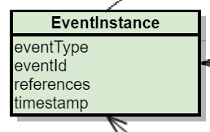

# Design decisions

The design choices below explain the structure shown in [Architecture](architecture.md).

## Architectural pattern

The PCS uses **ports and adapters** with an active domain model. State transitions and other domain
logic live in the model, which can be tested separately. Infrastructure and business-application plugins
implement adapters against ports.

This keeps transaction boundaries and responsibility for domain logic explicit. The alternative
considered was a layered architecture, which gives a less clearly defined structure.

## Persistence

- **Process instance**: the domain model is persisted directly with JPA annotations on the fields of the
  class. This avoids unnecessary mapping between JPA and the domain model; an independent persistence model
  would be desirable but hard to justify given the mapping effort.
- **Process template**: loaded from JSON resources on the classpath and held in memory. The process
  instance persists the template name and hash for change detection; the complete template is not
  stored as a database entity. See [Template migration](template-migration.md).
- **Process snapshot**: stored in an S3 object store as an Avro binary, together with the metadata required
  by the Process Archive Service.

**Rationale**: lower effort and complexity. A move to event sourcing remains possible if it later turns out
to be necessary.

| Option | Description                                                     | Advantages                                                            | Disadvantages                                                                                                     |
|--------|-----------------------------------------------------------------|-----------------------------------------------------------------------|-------------------------------------------------------------------------------------------------------------------|
| 1 (chosen) | Domain model persisted directly with JPA                    | Low effort, simple implementation                                     | Domain model has JPA dependencies; only the current state is known, not the history                                |
| 2      | Domain model in memory only, persistence via event sourcing     | Good traceability, good expected performance through inserts only     | Database harder to analyse, higher implementation effort, more complex through the decoupling of model and persistence |

## Asynchronous processing of messages affecting the process state

The PCS uses internal Kafka messages to separate the [processing stages](runtime-behavior.md#processing-stages).

The decision separated two questions: how to serialize updates per process instance, and how to make
message data available to conditions. Internal triggers keep transaction boundaries short and allow
internal topics to be partitioned independently from incoming business topics.

| Alternative considered | Advantages | Tradeoffs and evolution |
| --- | --- | --- |
| Pessimistic locking on a dedicated row per process | Simple implementation; serializes concurrent changes. | Waiting for locks can limit parallelism. Poorer performance was an assumption at design time, not a benchmark result. Replacing it later must preserve access to message data used by conditions. |
| Forward complete messages to an internal topic keyed by process ID | Serial processing per instance; conditions have the original payload available. | Forwarding contracts would expose PCS internals to integrating teams. A later replacement must also account for those contracts and payload access. |
| Persist extracted message data and send internal triggers (chosen) | Decouples incoming consumers from process updates; internal partitions can scale independently. | Extra persistence and processing stages add complexity. Extractors must retain the data needed by later conditions. |
| Optimistic locking with retry after a conflict | Avoids waiting for an exclusive lock during normal processing. | Retrying can produce status events more than once; consumers must be idempotent. A separate concurrency marker may be necessary when only part of the instance changes. |

For the trigger approach, alternatives for payload access were persisting the complete message,
rereading it from Kafka by offset, or exposing only its type and references. The implementation uses
[extracted message data](process-templates.md#payload-extractors) and the
[plugin context](domain-model.md#plugin-context); the original payload is not a general-purpose
condition API. See [Runtime behavior](runtime-behavior.md) for the current processing stages.

Other cluster synchronization mechanisms such as Hazelcast and event sourcing directly on Kafka were
not evaluated in detail. These alternatives describe the original design reasoning, not a commitment
to introduce them.

## Related

- [Runtime behavior](runtime-behavior.md)
- [Template migration](template-migration.md)
