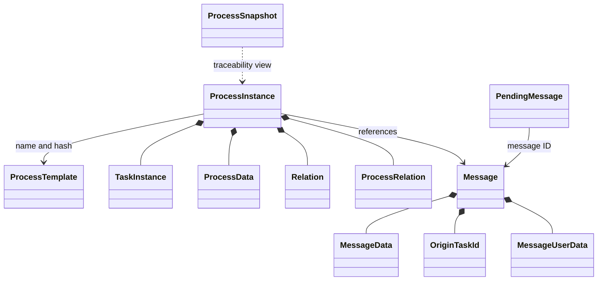
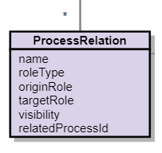
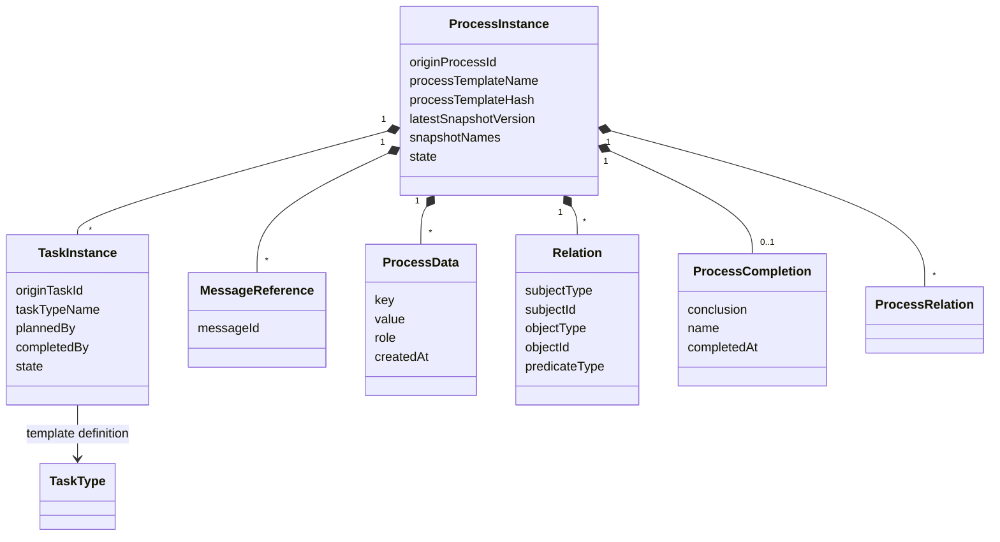
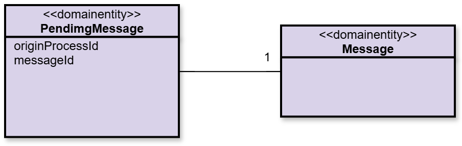
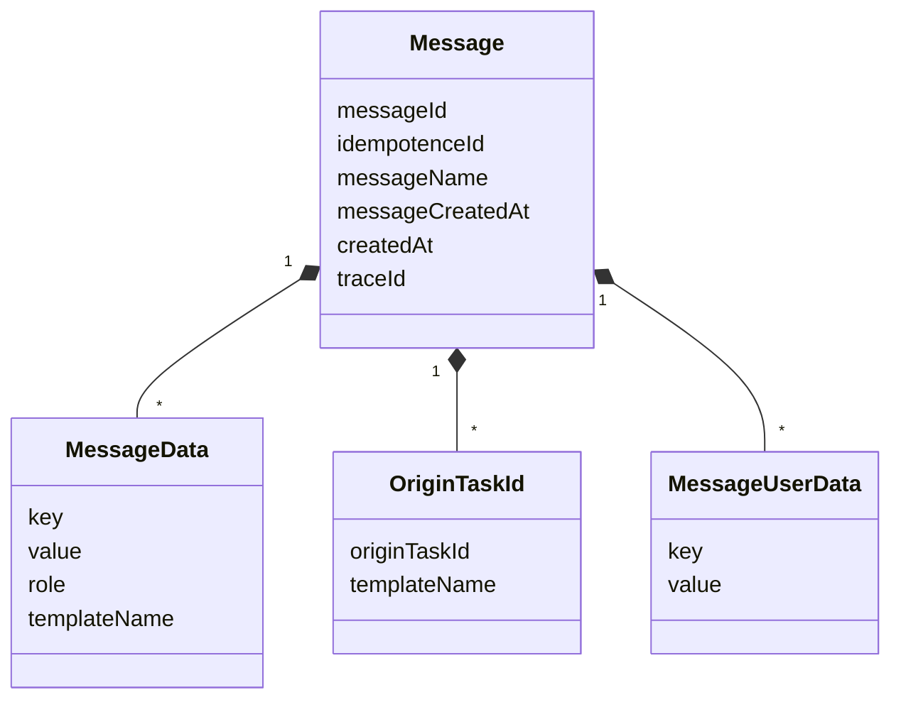
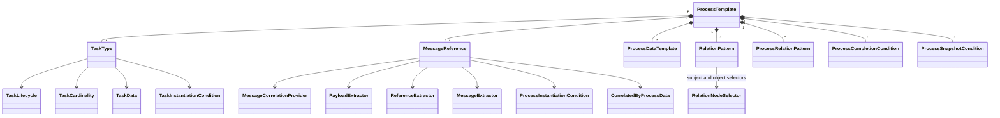
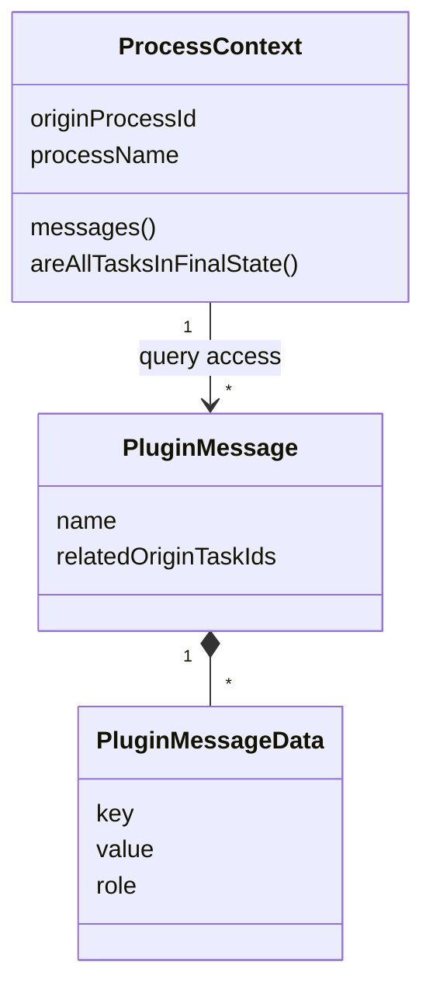

# Domain model

This page explains the relationships behind the [architecture](architecture.md#aggregate-roots).
The diagram is conceptual; source classes and template documentation define the complete current API.

## Process instance

The origin process ID identifies an instance. It records the template name and hash, process state,
completion conclusion, reason and time, and the latest snapshot version and snapshot names.
Tasks have their own origin task IDs, task types, states and planning/completion information.
[Task states](process-templates.md#tasks) and [process completion](process-templates.md#process-completion)
are defined in the template reference.

Process data consists of extracted keys, values and roles. Relations connect typed subject/object IDs
using a predicate; process relations connect process instances with named roles and visibility.
See [Process data](process-templates.md#process-data), [Relation patterns](process-templates.md#relation-patterns)
and [Process relations](process-templates.md#process-relations) for their distinct purposes.

The persistence implementation is in
[ProcessInstance](https://github.com/jeap-admin-ch/jeap-process-context-service/blob/master/jeap-process-context-domain/src/main/java/ch/admin/bit/jeap/processcontext/domain/processinstance/ProcessInstance.java)
and its associated domain classes. Persistent identity and timestamps are separate from the business
origin ID; use the API's documented identifiers when querying or scheduling maintenance.

### Process-instance structure

The diagram shows business attributes and relationships, not a complete persistence schema. Persistent
entities additionally carry their database identity and timestamps; mutable entities carry a version
for optimistic locking. Labels are resolved from template translations rather than persisted as task text.

The process state is `STARTED` or `COMPLETED`; completion conclusions are `SUCCEEDED`, `CANCELLED`
or `ABORTED`. Task states and their lifecycle-dependent transitions are described in
[Process templates](process-templates.md#task-state-transitions), including `UNKNOWN` and `DELETED`
for [template migration](template-migration.md).

## Message and pending message

A [Message](https://github.com/jeap-admin-ch/jeap-process-context-service/blob/master/jeap-process-context-domain/src/main/java/ch/admin/bit/jeap/processcontext/domain/message/Message.java)
records the incoming message identity, idempotence ID, name, timestamps and trace ID. Its extracted
message data contains keys, values and roles scoped to templates. Related origin task IDs are also
scoped to templates; user data provides additional information for the UI.

A [PendingMessage](https://github.com/jeap-admin-ch/jeap-process-context-service/blob/master/jeap-process-context-domain/src/main/java/ch/admin/bit/jeap/processcontext/domain/processinstance/PendingMessage.java)
associates a stored message ID with an origin process ID whose instance does not yet exist.
This is distinct from [late correlation](runtime-behavior.md#late-correlation) through process data.
Both allow messages to arrive before the information needed to attach them to a process is available.

### Message structure

Template scoping allows the same incoming message to serve several process templates without mixing
their task IDs or extracted values. Pending messages retain the target origin process ID even before
the process instance has been created.

## Process template

A [ProcessTemplate](https://github.com/jeap-admin-ch/jeap-process-context-service/blob/master/jeap-process-context-domain/src/main/java/ch/admin/bit/jeap/processcontext/domain/processtemplate/ProcessTemplate.java)
combines task types, message references, process-data definitions, relation patterns, process relations,
completion conditions and snapshot conditions. Message references select topics, correlation providers,
extractors and correlation-by-data definitions. Task types define cardinality, instantiation/completion
conditions and task-data extraction.

The [template reference](process-templates.md) owns the JSON structure and plugin contracts.
[Template migration](template-migration.md) explains how changes affect existing instances.

### Template composition

| Definition | Relevant information |
| --- | --- |
| Task type | Name, ordering, lifecycle, cardinality, planning/completion rules and displayed task data. |
| Message reference | Message name, topic, optional cluster, correlation provider, message/payload/reference extractors and instantiation/correlation conditions. |
| Process data | Destination key and source message/data key. |
| Process relation | Name, role type, origin and target roles, visibility, and source message/data key identifying the related process. |
| Relation pattern | Predicate and subject/object selectors, including process-data keys and roles. |
| Task data | Source message and selected message-data keys. |
| Correlation by process data | Mapping between an extracted message-data key and a process-data key. |

Use the [template JSON reference](process-templates.md) for exact field names and examples. The
lifecycle and cardinality are separate concepts; the old `single`/`dynamic` cardinality vocabulary is
supported only as a [legacy mapping](process-templates.md#tasks).

## Process snapshot

A snapshot is an Avro representation of the information needed for traceability at a given point in
time, not a complete copy of the persistence model. See [Process snapshots](process-templates.md#process-snapshots)
for creation, versioning and the archive REST interface.

## Plugin context

[ProcessContext](https://github.com/jeap-admin-ch/jeap-process-context-service/blob/master/jeap-process-context-plugin-api/src/main/java/ch/admin/bit/jeap/processcontext/plugin/api/context/ProcessContext.java)
exposes the origin process ID, process name and message queries to conditions. Plugin messages expose
their names, related origin task IDs and extracted message data. The plugin context is deliberately
separate from the persistence model: exposing mutable state changed by conditions would make results
depend on condition evaluation order. Its `areAllTasksInFinalState()` helper also requires at least
one task. See [Accessing messages in a condition](process-templates.md#accessing-messages-in-a-condition).

The names in this diagram distinguish the plugin-facing message view from the persistent `Message`
aggregate; the Java plugin interfaces are documented in the linked plugin context above.

## Related

- [Architecture](architecture.md)
- [Runtime behavior](runtime-behavior.md)
- [Design decisions](design-decisions.md)
- [Maintenance jobs](maintenance-jobs.md)
