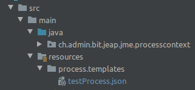
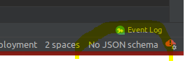
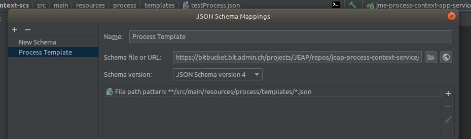
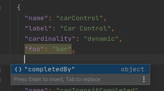

# Getting Started

This guide describes how to set up an instance of the Process Context Service (PCS) for a business
application. For the process definition itself see [Process Templates](process-templates.md), for the
available properties see [Configuration](configuration.md).

## How it works

See the [runtime overview](runtime-behavior.md#runtime-overview) for message ingestion, process updates,
snapshots and integration with PAS and EHS. The PCS observes the process; the participating business
services remain responsible for executing it.

## 1. Create a service instance

The PCS is published as a **library**. Every business application creates its own instance, i.e. a source
code repository containing:

- a POM referencing the process context library and the plugin API,
- the configuration files (`application-<env>.yml`),
- optionally Java code for conditions and plugins,
- the process templates and their translations.

If the instance is **not** part of a multi-module project, use `jeap-process-context-service-instance`
directly as the Maven parent. This makes the explicit `jeap-process-context-scs` and
`jeap-process-context-plugin-api` dependencies unnecessary:

```xml
<parent>
    <groupId>ch.admin.bit.jeap</groupId>
    <artifactId>jeap-process-context-service-instance</artifactId>
    <version>use-the-latest-version-here</version>
    <relativePath/>
</parent>
```

Inside a multi-module project, declare the dependencies explicitly:

```xml
<dependencies>
    <dependency>
        <groupId>ch.admin.bit.jeap</groupId>
        <artifactId>jeap-process-context-scs</artifactId>
        <version>${jeap-process-context-service.version}</version>
    </dependency>
    <dependency>
        <groupId>ch.admin.bit.jeap</groupId>
        <artifactId>jeap-process-context-plugin-api</artifactId>
        <version>${jeap-process-context-service.version}</version>
    </dependency>
</dependencies>
```

> In multi-module projects, make sure the `jeap-spring-boot-parent` version used by your parent matches the
> one used by the PCS dependencies.

The main class of the application is `ch.admin.bit.jeap.processcontext.Application`.

## 2. Order the Kafka topics

The PCS produces and consumes messages, so the following topics have to exist for every instance:

| Configuration key (`jeap.processcontext.kafka.topic.*`) | Naming proposal                          | Usage                                                                                        |
|---------------------------------------------------------|------------------------------------------|----------------------------------------------------------------------------------------------|
| `process-outdated-internal`                             | `<system>-process-processoutdated-internal` | Internal. Controls the maximum internal parallelism of the PCS — increase the partition count under high load. |
| `process-snapshot-created`                              | `<system>-process-snapshotcreated`       | `ProcessSnapshotCreatedEvent`. Only required if process snapshots are configured.             |

Additionally, the PCS needs at least read permission on every topic carrying the messages referenced in its
process templates.

### Scaling and concurrency

See [Operations](operations.md#scaling) for partition sizing and listener concurrency.

## 3. Order the user role

Assign the process-instance view role described in [User Interface](user-interface.md#roles).
That section also documents the system-name settings used to construct role names.

## 4. Configure the application

The following excerpt shows service-specific settings. Complete it with the deployment's datasource
connection and credentials, Kafka/schema-registry connection and authentication, OAuth issuer,
[frontend URLs and PAMS mode](configuration.md#frontend-and-oauth), and [log link](configuration.md#log-deep-link).
If templates enable snapshots, configure the snapshot bucket and storage access as well. See the
[complete integration examples](#complete-integration-examples) for the full deployment configuration.

```yaml
server:
  servlet:
    context-path: /process-context

spring:
  application:
    name: jme-process-context-scs
  jpa:
    properties:
      hibernate:
        default_schema: data
  datasource:
    hikari:
      schema: ${spring.jpa.properties.hibernate.default_schema}
  flyway:
    # Flyway automatically creates the default schema if it does not exist
    default-schema: ${spring.jpa.properties.hibernate.default_schema}

jeap:
  messaging:
    kafka:
      error-topic-name: jme-messageprocessing-failed
      system-name: JME
      service-name: ${spring.application.name}
  processcontext:
    kafka:
      topic:
        process-outdated-internal: "jme-process-event-received"
        process-snapshot-created: "jme-process-snapshotcreated"
    frontend:
      client-id: "process-context"
      system-name: "jme"
      silent-renew: true
      auto-login: true
      renew-user-info-after-token-renew: true
      logout-redirect-uri: "https://localhost:8080/logout"
    objectstorage:
      snapshot-retention-days: 3
  security:
    oauth2:
      resourceserver:
        system-name: "jme"
```

See [Configuration](configuration.md) for the complete property reference.

## 5. Create the process templates

The PCS loads its process templates from the classpath, matching the pattern
`process/templates/*.json`. The structure of a template is described in
[Process Templates](process-templates.md).



### JSON schema support in the IDE

A JSON schema for process templates is available at
`jeap-process-context-repository-template-json/src/main/schema/process-template-schema.json`. Registering it
in the IDE provides code completion and validation while editing templates. In IntelliJ IDEA, open a process
template and use *No JSON schema* in the status bar → *New Schema Mapping*:

- **Schema file or URL**: the schema file above
- **File path pattern**: `**/src/main/resources/process/templates/*.json`

The screenshots below illustrate the IDE workflow. Their UI and schema URL are from an older setup;
use the current schema file and path pattern above.







## 6. Instantiate processes

Process instances are created by **messages** (domain events or commands). Set `triggersProcessInstantiation`
or `processInstantiationCondition` on the corresponding message declaration in the process template, see
[Process instantiation](process-templates.md#process-instantiation).

## 7. Optional steps

- **Custom conditions, payload and reference extractors** — see [Process Templates](process-templates.md).
- **Relation listener** — implement `RelationListener` as a Spring bean to be notified about newly
  discovered relations between business objects, see [Relation patterns](process-templates.md#relation-patterns).
- **Message filters** — ignore irrelevant messages of a given type, see
  [Message filters](configuration.md#message-filters).
- **Encrypted Kafka records** — see [Configuration](configuration.md#encrypted-kafka-records) for
  dependencies and connection settings.
- **Housekeeping and template migration scheduling** — see [Configuration](configuration.md).

## Complete integration examples

The following source examples include the complete build, configuration and plugin implementations.
Use them with the version of the service you integrate; the examples evolve with their repositories.

- [jme-process-context-example](https://github.com/jme-admin-ch/jme-process-context-example)
- [jme-process-context-example / jme-process-context-scs/pom.xml](https://github.com/jme-admin-ch/jme-process-context-example/blob/main/jme-process-context-scs/pom.xml)
- [jme-process-context-example / jme-process-context-scs / JmeRaceMobileCheckpointPassedEventPayloadExtractor.java](https://github.com/jme-admin-ch/jme-process-context-example/blob/main/jme-process-context-scs/src/main/java/ch/admin/bit/jeap/jme/processcontext/event/JmeRaceMobileCheckpointPassedEventPayloadExtractor.java)
- [jme-process-context-example / jme-process-context-scs / JmeRaceStartedEventMessageFilter.java](https://github.com/jme-admin-ch/jme-process-context-example/blob/main/jme-process-context-scs/src/main/java/ch/admin/bit/jeap/jme/processcontext/event/JmeRaceStartedEventMessageFilter.java)
- [jme-process-context-example / jme-process-context-scs/src/main/resources/application.yml](https://github.com/jme-admin-ch/jme-process-context-example/blob/main/jme-process-context-scs/src/main/resources/application.yml)
- [jme-process-context-example / jme-process-context-scs/src/main/resources/process/messages/messages.properties](https://github.com/jme-admin-ch/jme-process-context-example/blob/main/jme-process-context-scs/src/main/resources/process/messages/messages.properties)
- [jme-process-context-example / jme-process-context-scs/src/main/resources/process/messages/messages_fr.properties](https://github.com/jme-admin-ch/jme-process-context-example/blob/main/jme-process-context-scs/src/main/resources/process/messages/messages_fr.properties)
- [jme-process-context-example / jme-process-context-scs/src/main/resources/process/messages/messages_it.properties](https://github.com/jme-admin-ch/jme-process-context-example/blob/main/jme-process-context-scs/src/main/resources/process/messages/messages_it.properties)
- [jme-process-context-example / jme-process-context-scs/src/main/resources/process/templates/raceProcess.json](https://github.com/jme-admin-ch/jme-process-context-example/blob/main/jme-process-context-scs/src/main/resources/process/templates/raceProcess.json)
- [jme-process-context-example / jme-process-context-scs](https://github.com/jme-admin-ch/jme-process-context-example/tree/main/jme-process-context-scs)
- [jme-process-context-example / jme-process-context-scs / condition](https://github.com/jme-admin-ch/jme-process-context-example/tree/main/jme-process-context-scs/src/main/java/ch/admin/bit/jeap/jme/processcontext/condition)
