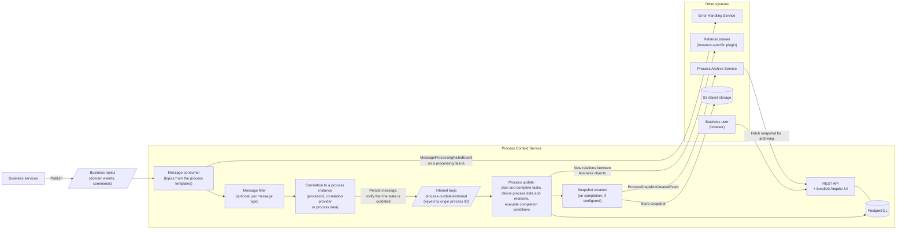
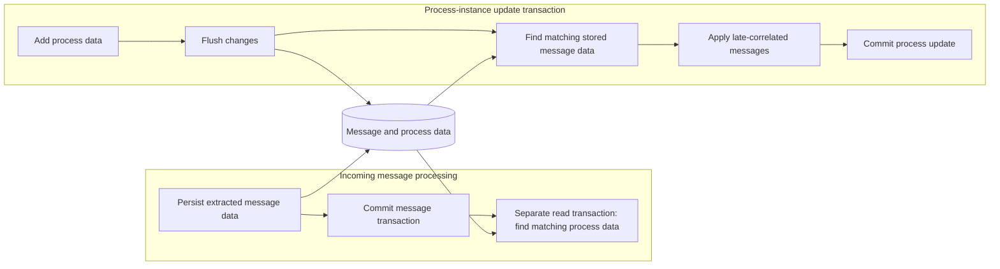
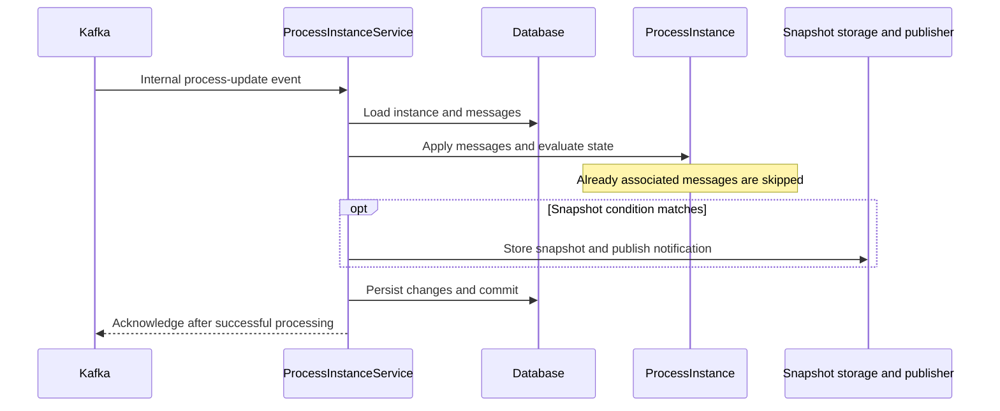

# Runtime behavior

This page describes PCS message processing. See [Architecture](architecture.md) for goals,
context and the domain model, and [Design decisions](design-decisions.md) for the rationale.

## Runtime overview

The PCS consumes the messages declared in its process templates, keeps the state of the process instances up
to date, and publishes what it has derived from them:

For serial processing per process instance, see [Asynchronous notifications and eventual consistency](#asynchronous-notifications-and-eventual-consistency).
Snapshot creation and the PAS integration are described under [Process snapshots](process-templates.md#process-snapshots).

## Messages

### Published events

| Event type                    | References        | Payload           | Description                            |
|-------------------------------|-------------------|-------------------|----------------------------------------|
| `ProcessSnapshotCreatedEvent` | `originProcessId` | `snapshotVersion` | A new process snapshot version was created. |

### Consumed messages

Domain events and commands, depending on the business application. References to process and task are
extracted by correlation providers, data by custom payload and reference extractors.

### Internal messages

Internal Kafka messages decouple the processing steps inside the PCS. They decouple the processing from the
partitioning of the source topics, shorten transactions, simplify error handling and generally increase
robustness. These technical messages are modelled as jEAP domain events.

| Topic (configuration key)  | Message type                  | Payload                                                                               | Description                                                                                     |
|----------------------------|-------------------------------|---------------------------------------------------------------------------------------|-------------------------------------------------------------------------------------------------|
| `jeap.processcontext.kafka.topic.process-outdated-internal` | `ProcessContextOutdatedEvent` | `originProcessId`, `processUpdateType`, optional message/template data or maintenance task envelope | Something happened for a process instance that potentially affects its state, or a durable maintenance task must be executed. |
| `jeap.processcontext.kafka.topic.add-process-data-command` | `AddProcessDataCommand` | Maintenance job/task identity, template, origin process ID, and normalized process-data values | Adds durable backfill data and triggers relation reevaluation through the internal process-outdated event flow. |

Maintenance messages use the transactional outbox and the origin process ID as Kafka key.
For task transitions, transaction boundaries and contract exemptions, see
[Maintenance jobs](maintenance-jobs.md#common-task-lifecycle).

## Processing stages

The regular message flow has two processing stages separated by the internal Kafka topic:

1. `MessageService` extracts and persists message data, related task IDs and user data. It then
   correlates the message to origin process IDs in a separate read transaction.
   `ProcessUpdateService` publishes a `ProcessContextOutdatedEvent` for each correlated instance.
2. The internal consumer calls `ProcessInstanceService` to create or update the process instance.
   This update derives process data and relations, evaluates tasks and process completion, and invokes
   snapshot creation when its conditions match. `ProcessSnapshotService` stores the snapshot and
   publishes `ProcessSnapshotCreatedEvent` during this processing path.

Snapshot creation is not a third Kafka-separated reaction stage. The internal topic serializes
process updates independently of the partitions of the incoming business topics.
[Maintenance jobs](maintenance-jobs.md) have their own durable task and outbox lifecycle.

## Asynchronous notifications and eventual consistency

Message processing per process instance must **not** happen in parallel. Serial processing per process
instance is essential to avoid race conditions. Task evaluation supports messages arriving out of
order; this does not establish a global ordering across business topics. This is achieved
with the internal processing events described above: they use the process instance ID as the Kafka record
key, which serialises the consumption of the events per process instance ID.

## Late correlation

Correlation based on process data allows a message to be assigned to a process instance based on information
that becomes known to the instance only after the process has started.

- If the message **writing** the process data is processed **before** the message to be correlated, the
  correlation already happens in the `MessageService` by searching for a process with the relevant
  process data (*early correlation*).
- If the messages arrive in the opposite order, that search finds nothing. The message is stored first and
  correlated later, when the relevant process data becomes known (*late correlation*). Late correlation
  happens in the `ProcessInstanceService`, which writes the process data: whenever it creates new process
  data, it checks whether already received messages can now be correlated.

`MessageService` commits the extracted message before querying for matching process data in a
separate transaction. During a process update, `ProcessInstanceService` flushes newly added process
data, queries stored messages and applies matching messages within the current update transaction.
Already associated messages are excluded or skipped by the idempotence check. These are the current
transaction boundaries; a flush does not commit the process-update transaction.

### Correlation transaction diagram

Incoming message transactions can run in parallel across topics. Internal Kafka partitioning serializes
updates for the same process instance. As described above, flushing process data makes it available to
queries in that transaction; it does not commit it for concurrent transactions.

## Idempotency

- **Process creation** is idempotent via the origin process ID: if an instance already exists, the creation
  is ignored.
- Events triggered by state changes are published successfully **before** the triggering message is
  acknowledged. If processing fails, the original message is passed to the error handling and acknowledged;
  a retry then relies on the idempotent processing again.

### Publication and acknowledgment sequence

The database, object store and Kafka are separate systems. A failure after an external side effect can
cause redelivery; idempotent processing and stable notification identifiers are needed. This is the
regular message path; [maintenance jobs](maintenance-jobs.md) have their own transactional outbox flow.

## Error handling

Message-processing failures are delegated to the
[Error Handling Service](https://jeap-admin-ch.github.io/docs/building-blocks/reusable-microservices/jeap-error-handling/message-flows).
For exceptions passed to `InternalMessageConsumerException.from`, the classification is:

| Exception                                              | Classification |
|--------------------------------------------------------|----------------|
| `org.springframework.dao.TransientDataAccessException` | Temporary      |
| `org.apache.kafka.common.errors.RetriableException`    | Temporary      |
| Everything else                                        | Permanent      |

## Related

- [Operations](operations.md) — scaling and metrics
- [Maintenance jobs](maintenance-jobs.md) — maintenance task execution
